# Chicago Weather Trends, 2015–2024

An end-to-end exploratory analysis of ten years of daily weather in Chicago: retrieving data from a public API, validating and cleaning it, engineering features, testing trends statistically, and turning the results into publication-quality figures.

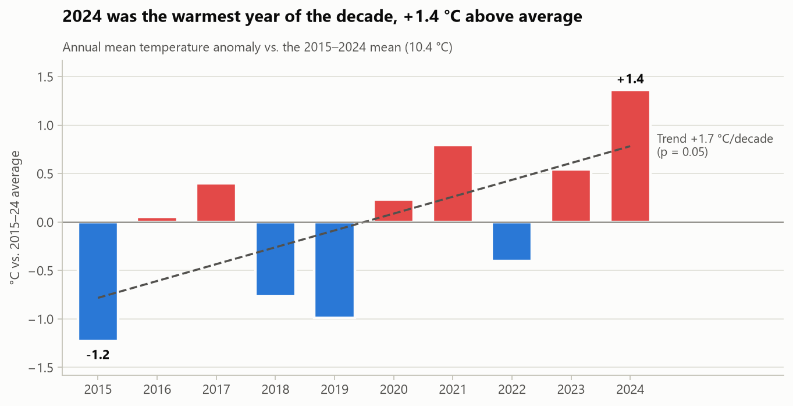

## Key findings

| # | Finding | Evidence |
|---|---|---|
| 1 | **The decade warmed, but the record is short.** 2024 was the warmest year (11.8 °C, +1.4 °C above the decade mean). | Annual-mean trend +1.7 °C/decade, borderline significant (OLS p = 0.050, Kendall p = 0.047) |
| 2 | **Hot days are the clearest trend.** Days ≥ 32.2 °C (90 °F) went from 0 in 2015–16 to 12 in 2021 and 2024. | +12 days/decade, p = 0.004, R² = 0.67 |
| 3 | **Spring is the only season with a significant trend.** Winter swings too much year to year to show one. | Spring +3.1 °C/decade (p = 0.01); winter +0.9 (p = 0.65) |
| 4 | **Cold extremes are larger than warm ones.** 30 of 37 days beyond ±3σ were cold outbreaks, led by the Jan 2019 polar vortex (−32.5 °C). | Daily anomaly vs. 31-day-smoothed day-of-year normal |
| 5 | **Precipitation has no trend but is concentrated.** About 1,166 mm/yr, peaking May–July. The heaviest 1.8 % of days deliver 21 % of the total, and the decade's largest day was 2 Jul 2023 (138 mm). | Wet-day 95th percentile = 25.3 mm |
| 6 | **Cloud cover ties the system together.** The chance of a wet day rises from 0 % under clear skies to 74 % when overcast, and the day–night temperature range shrinks from 8.7 °C to 4.9 °C. | Spearman correlations, binned analysis |

> ⚠️ Ten years is weather-scale, not climate-scale. Trends here are descriptive and sensitive to start and end years. See [Limitations](#limitations).

## Data

| | |
|---|---|
| Source | [Open-Meteo Historical Weather API](https://open-meteo.com/en/docs/historical-weather-api) (ERA5 reanalysis) |
| Location | Chicago Loop, 41.88° N, 87.63° W (grid cell 41.86° N, 87.65° W, 241 m) |
| Period | 1 Jan 2015 – 31 Dec 2024, daily: **3,653 rows** |
| Variables | Max/min/mean and feels-like temperature, precipitation, rain, snowfall, precipitation hours, max wind and gusts, solar radiation, humidity, cloud cover, sea-level pressure |

## Method

```
src/fetch_data.py     Open-Meteo API ──► data/raw/            (JSON + CSV, with retry/back-off)
src/prepare_data.py   validate ─► clean ─► engineer features ──► data/processed/
notebooks/            exploratory analysis, statistics, figures ──► figures/
```

**Validation.** Before analysis, the data is checked for duplicate and missing dates, missing values, physically impossible values (per-variable bounds), and internal consistency (min ≤ mean ≤ max, rain ≤ total precipitation, gusts ≥ sustained wind). Results are written to `data/processed/data_quality_report.json`. All checks passed for this extract. The cleaning logic (bounds to NaN, time-interpolation of gaps ≤ 3 days, precipitation never interpolated) still runs, so the pipeline is safe to re-run on other locations or periods.

**Feature engineering.** Meteorological seasons (December assigned to the following winter), diurnal temperature range, threshold flags (wet ≥ 1 mm, heavy ≥ wet-day P95, hot ≥ 32.2 °C, freezing min < 0 °C, ice max < 0 °C), and daily temperature anomalies against a 31-day circularly smoothed day-of-year climatology, with ±3σ outlier flags.

**Statistics.** Trends use OLS regression together with Kendall's τ, a non-parametric Mann-Kendall-style test that is robust to outliers. A trend is called significant only when both agree at p < 0.05. Seasonal trends use complete seasons only. Relationships use Spearman rank correlation, because precipitation is heavily skewed.

## Figures

| | |
|---|---|
| 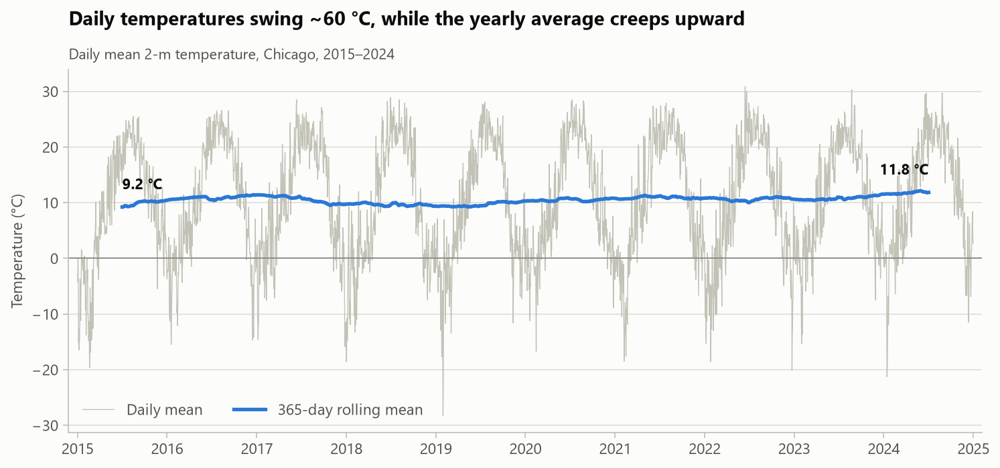 | 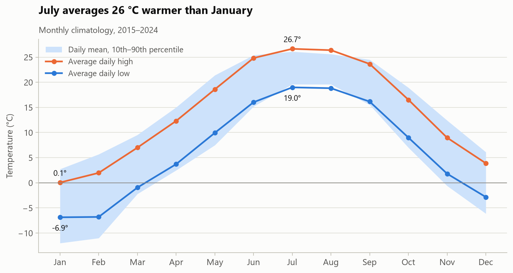 |
| 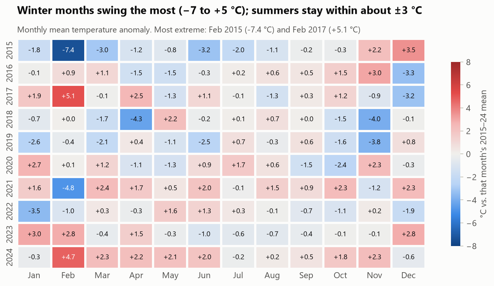 | 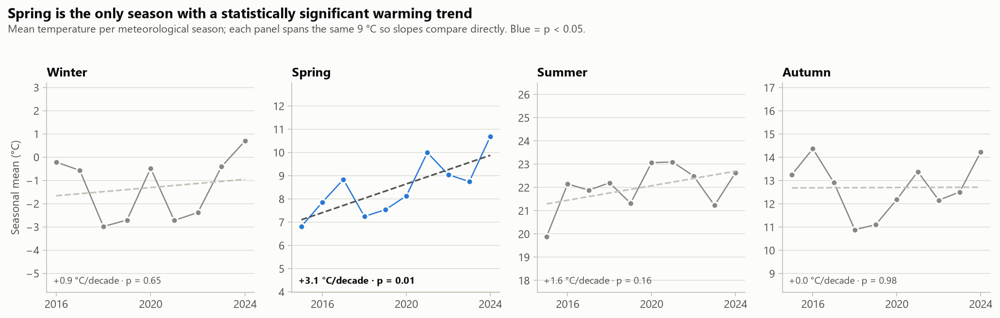 |
| 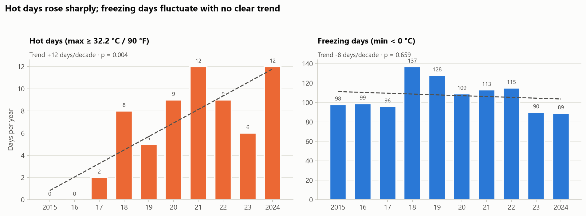 | 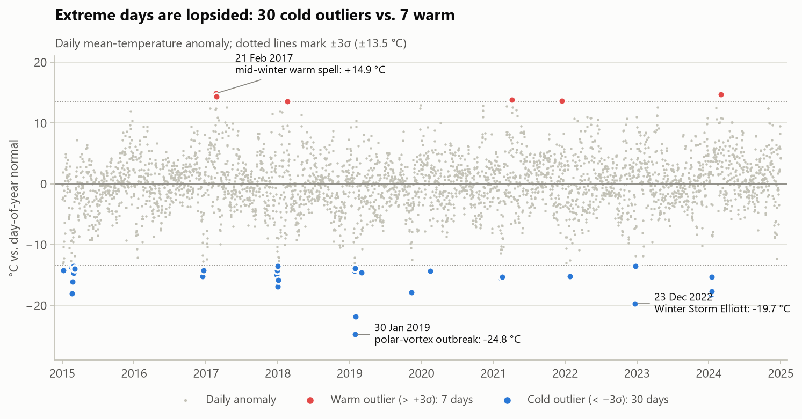 |
| 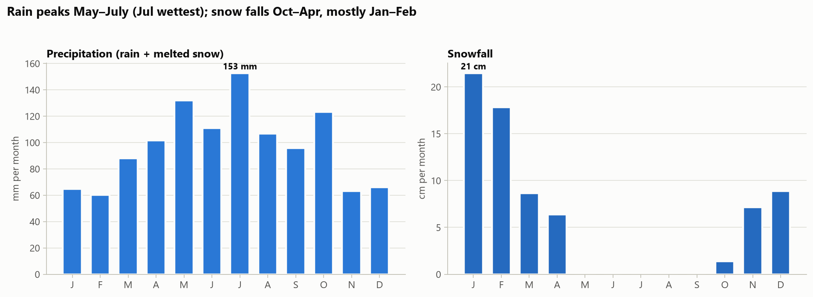 | 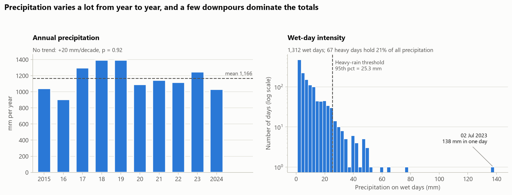 |
| 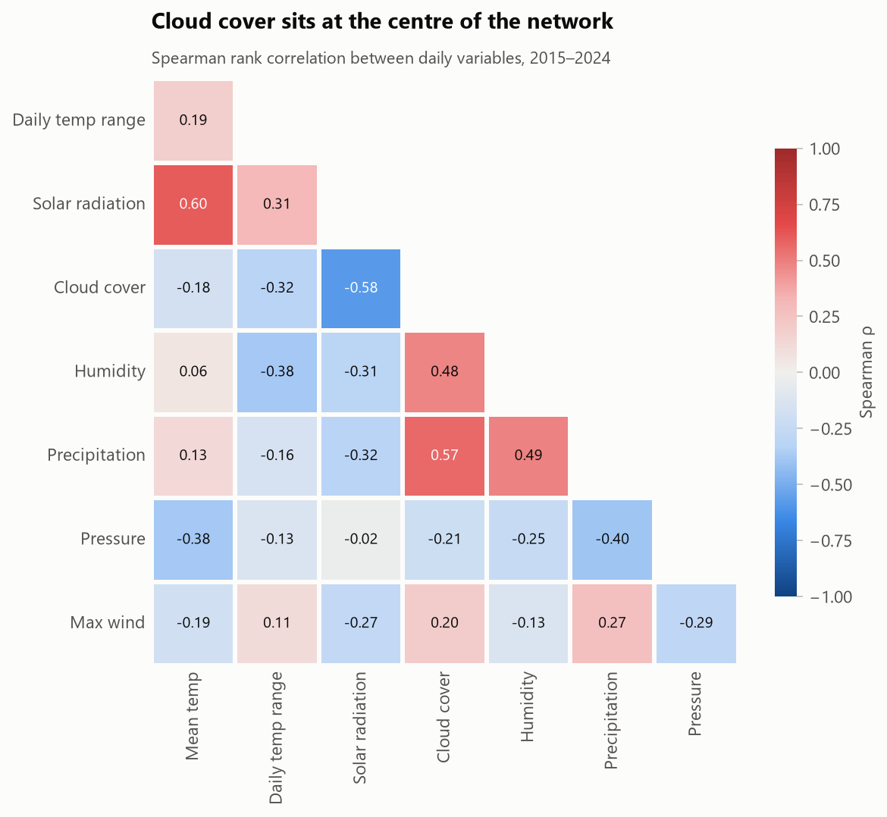 | 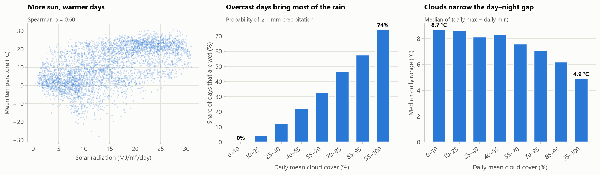 |

## Reproduce

```bash
python -m venv .venv
.venv\Scripts\activate          # macOS/Linux: source .venv/bin/activate
pip install -r requirements.txt
python src/fetch_data.py
python src/prepare_data.py
jupyter nbconvert --to notebook --execute --inplace notebooks/chicago_weather_analysis.ipynb
```

No API key is needed. To analyse another city or period, change `LOCATION`, `START_DATE` and `END_DATE` in `src/fetch_data.py`.

## Limitations

- **Reanalysis, not a station.** ERA5 is modelled on a ~25 km grid. It is gap-free and consistent, but it smooths local extremes, especially convective rainfall, compared with O'Hare or Midway gauges.
- **Short record.** Ten annual points make trend estimates sensitive to individual years. Robust climate trends need ≥ 30 years.
- **Internal baseline.** Anomalies are relative to 2015–2024, not to the official 1991–2020 normals.
- **Correlation ≠ causation.** Raw daily correlations also include the shared seasonal cycle.

## Next steps

Validate against NOAA station data, extend to 1950–2024, deseasonalise before correlating, and add a monthly temperature forecast (SARIMA / Prophet).

## Tools

Python · Requests · Pandas · NumPy · SciPy · Matplotlib · Seaborn · Jupyter Notebook
